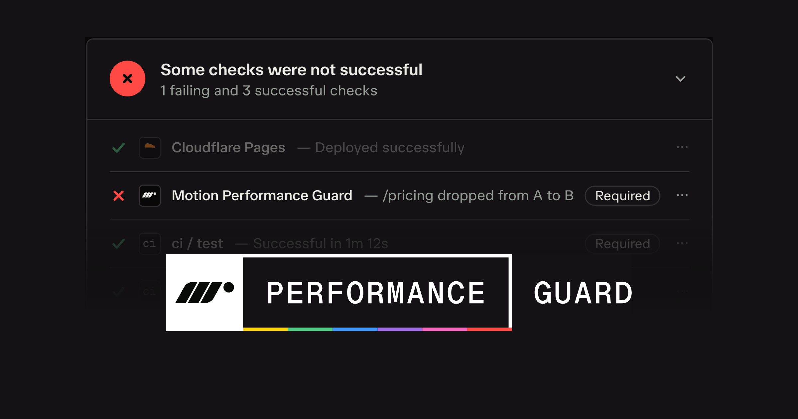

# Motion Performance Guard demo

This repo shows Motion Performance Guard stopping an animation regression before it merges.



Unit tests pass. The preview deploys. The page still feels slower than it did on Monday.

Guard catches that. It audits your pages with [MotionScore](https://motion.dev/docs/motionscore) on every pull request, compares each page with your main branch, and fails the check when an animation gets worse.

## See it in action

- **[A page made slower](https://github.com/motiondivision/performance-guard-demo/pull/2)**: the pull request swaps a smooth CSS animation for 300 boxes animated from JavaScript, with a forced layout read on every frame. Guard fails the check, and its comment shows the page dropping from S to F, names the problem (frame thrashing) and the element, and gives a fix prompt you can paste into your coding agent. The regression was then accepted with the `performance-ok` label and `/guard accept`, so you can see waivers too.
- **[A text change](https://github.com/motiondivision/performance-guard-demo/pull/3)**: nothing that moves has changed, so the check passes.

## How it works

1. A workflow runs the Guard Action on your own runner. It audits your pages with MotionScore, so audits are unlimited.
2. Pushes to `main` record a baseline grade for each page.
3. Each pull request is compared with that baseline. The Motion Performance app posts one comment and a check named **Motion Performance Guard**.
4. Make the check required, and a regression can't merge. A maintainer can still accept it with the `performance-ok` label or a `/guard accept` comment.

This is the whole workflow in this repo. It serves the `site/` folder on the runner, so it needs no preview deploys:

```yaml
name: Motion Performance Guard
on:
  push:
    branches: [main]
  pull_request:
  workflow_dispatch:
permissions:
  id-token: write
  contents: read
jobs:
  guard:
    runs-on: ubuntu-latest
    steps:
      - uses: actions/checkout@v4
      - id: guard
        uses: motiondivision/motionscore-guard@v2
        with:
          url: http://localhost:4173
          pages: /
          serve: npx --yes serve@14 -l 4173 site
```

Got preview deploys on Vercel or Netlify? Guard can audit those instead. The [docs](https://motion.dev/docs/performance-guard) have both setups.

## Add Guard to your repo

1. Open the [Guard dashboard](https://motion.dev/dashboard/guard) and install the Motion Performance app on your GitHub organisation.
2. Add the workflow.
3. Push to `main` to record a baseline, then open a pull request.

The full guide is in the [Performance Guard docs](https://motion.dev/docs/performance-guard).

## Guard is part of Motion Cloud

Performance Guard comes with [Motion Cloud](https://motion.dev/cloud). Each person who opens pull requests needs a seat. Pull requests from bots, such as Dependabot, use the seat that installed the app.
